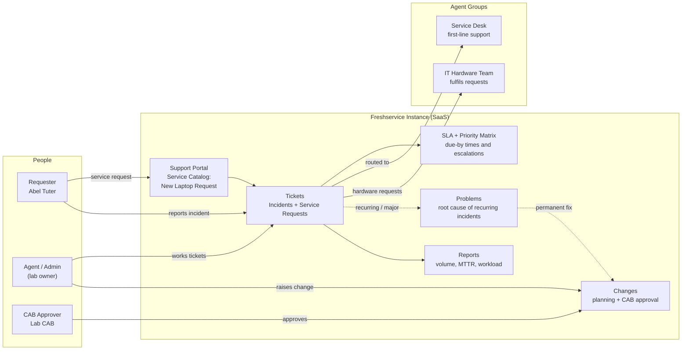
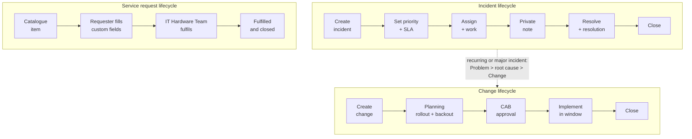
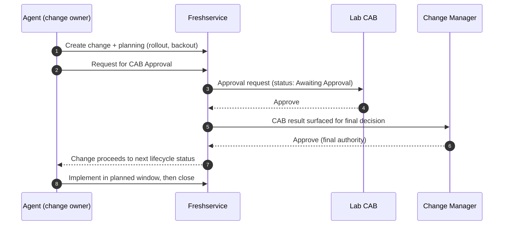

# Freshservice ITSM

-orange)

A hands-on IT Service Management (ITSM) lab built on the Freshservice. It walks through the full ITIL process set an IT support team uses every day: **incident management, service requests (catalogue), change management with CAB approval, SLA/priority configuration, and reporting.**

## 🎬 Watch Me Build This Lab!

## Table of Contents

1. [Overview](#overview)
2. [Business Problem](#business-problem)
3. [Architecture](#architecture)
4. [Prerequisites](#prerequisites)
5. [Step 1 — Provision the Trial Instance](#step-1--provision-the-trial-instance)
6. [Step 2 — Navigate the Platform and Seed Test Data](#step-2--navigate-the-platform-and-seed-test-data)
7. [Step 3 — Configure Priority and SLA, Then Work an Incident](#step-3--configure-priority-and-sla-then-work-an-incident)
8. [Step 4 — Build a Service Catalogue Item](#step-4--build-a-service-catalogue-item)
9. [Step 5 — Change Request with CAB Approval](#step-5--change-request-with-cab-approval)
10. [Step 6 — Build Reports](#step-6--build-reports)
11. [ITIL Concepts Mapped to Freshservice](#itil-concepts-mapped-to-freshservice)
12. [ServiceNow to Freshservice Quick Reference](#servicenow-to-freshservice-quick-reference)
13. [Security and Governance Considerations](#security-and-governance-considerations)
14. [Troubleshooting](#troubleshooting)
15. [Screenshots and Portfolio Evidence](#screenshots-and-portfolio-evidence)
16. [Skills Demonstrated](#skills-demonstrated)
17. [References](#references)

---

## Overview

| Field | Value |
|---|---|
| Platform | Freshservice (cloud ITSM), 14-day free trial with all features unlocked |
| Certification alignment | CompTIA A+, Network+, ITIL 4 Foundation |
| Time to complete | 2–3 hours across multiple sessions, inside the 14-day trial window |
| Estimated cost | $0 during the trial (paid plan required after day 14) |
| Career relevance | IT Support, Help Desk, Sysadmin, ITSM Platform Administrator |

### What this lab covers

- Create, work, and resolve an **Incident**
- Configure the **Priority Matrix** and **SLA policy**
- Route tickets to **groups and agents**
- Build a **Service Catalogue** item with custom fields
- Run a **Change** through planning and **CAB approval**
- Link ITIL records (Incident, Problem, Change)
- Build **reports** for volume, MTTR, and agent workload

---

## Business Problem

When users report IT problems, those problems must be tracked, routed, prioritised, assigned, worked, and resolved consistently and auditably. Without a structured system, work falls through the cracks: a server goes down, three people report it to three different team members, nobody knows who owns it, and a one-hour fix takes four.

An ITSM platform solves this by enforcing process:

- **Incidents** follow an incident workflow
- **Change requests** require approval before work begins
- **Service requests** come from a catalogue with predefined fulfilment steps

Tickets, priorities, SLAs, approvals, and reports are the same concepts on every ITSM platform (Freshservice, ServiceNow, Jira Service Management), so the experience here transfers directly.

| Role | How this lab applies |
|---|---|
| IT Support / Help Desk | Creating and resolving incidents is the core daily task |
| Sysadmin | Logging, approving, and documenting infrastructure changes |
| IT Service Manager | Building catalogues, defining workflows, reporting on SLA compliance |
| Cloud Engineer | Change requests, incident management, and service requests for cloud resources |

---

## Architecture

### Figure 1 — Lab architecture: people, modules, and agent groups

### Figure 2 — Incident, service request, and change lifecycles

### Trust and control points

| Control point | Where it appears | Purpose |
|---|---|---|
| Requester vs Agent separation | Portal vs agent interface | Users submit; only staff work tickets |
| Private Notes | Incident work | Internal troubleshooting detail hidden from the requester |
| CAB approval | Change request | Prevents uncoordinated production changes |
| Change Manager final decision | Change request | Freshservice never auto-approves; accountability stays with a named role |
| SLA policy | Incident | Commits the team to measurable response and resolution times |

---

## Prerequisites

- A Freshservice trial account (freshworks.com/freshservice)
- An email address that will stay active for the trial (a school or custom-domain address is safest; avoid an employer address that could be deactivated)
- A browser and 2–3 hours across the 14-day trial window
- The **trial's all-features plan**. Problem and Change management sit on the Pro plan, so stay on the trial plan through Step 5

> **The clock is running.** The trial lasts 14 days. Complete the lab, capture every screenshot, and download your reports as PDF before day 14. Trial length and plan names can change, so confirm on the signup page.

> **No credit card should be required.** Freshworks advertises no card for the trial. If the form asks for one, stop and check the current offer first.

---

## Step 1 — Provision the Trial Instance

1. Go to **freshworks.com/freshservice**.
2. Click **Start free trial** (14-day trial, all features).
3. Enter first name, last name, company name, and work email. A company name such as `Lab4 IT Lab` works well.
4. Verify the email and answer the short onboarding questions. Skip inviting teammates.
5. Note your instance URL (format: `yourcompany.freshservice.com`) and log in.

**Verify:** you land in the agent interface with the left sidebar and the Admin (gear) icon visible.

---

## Step 2 — Navigate the Platform and Seed Test Data

### Key modules

| Module | Location | Purpose |
|---|---|---|
| Incident | Tickets > New > Incident | Primary module for IT support tickets |
| Problem | Problems | Root cause analysis for recurring incidents |
| Change | Changes | Planned modifications to infrastructure |
| Service Catalog | Admin > Service Management > Service Catalog | User-facing request portal |
| Reports | Reports > New Report (also Reports > Analytics) | Analytics and metrics |
| Workflow Editor | Admin > Automation & Productivity > Automation > Workflow Automator | Visual workflow builder |

> **Menus move around.** Freshservice changes its interface often. Paths here follow Freshservice's support documentation as of October 2026. If you have several workspaces, Admin paths include the workspace name. If a path does not match, look for the nearest equivalent label under Admin.

### Seed the test data

A new trial has no demo users, so create what the lab needs:

| # | Item | Path | Value |
|---|---|---|---|
| 1 | Test requester | Admin > User Management > Requesters > New Requester | Abel Tuter, `abel.tuter@example.com` (made-up address is fine) |
| 2 | Two agent groups | Admin > User Management > Groups > New Group | `Service Desk` and `IT Hardware Team`, add yourself to both |
| 3 | Change Advisory Board | Admin > User Management > CAB > New CAB | `Lab CAB`, add yourself as a member |
| 4 | In Progress status | Admin > Service Management > Service Desk Settings > Field Manager > Ticket Fields > Status > + Add item | `In Progress` (defaults are Open, Pending, Resolved, Closed) |

**Verify:** Abel Tuter appears under Requesters, both groups list you as a member, Lab CAB exists, and *In Progress* appears in the Status dropdown on a new ticket.

---

## Step 3 — Configure Priority and SLA, Then Work an Incident

### 3a. Enable the Priority Matrix (one-time setup)

Priority drives the SLA clock, so configure both **before** creating the ticket.

Path: **Admin > Service Management > Service Desk Settings > Priority Matrix** and toggle **Enable Priority Matrix**.

| Impact \ Urgency | Low | Medium | High |
|---|---|---|---|
| **Low** | Low | Medium | Medium |
| **Medium** | Medium | Medium | High |
| **High** | High | High | Urgent |

### 3b. Set the SLA policy

Path: **Admin > Service Management > Service Desk Settings > SLA and OLA Policies**. Edit the **Default SLA Policy**, fill in the time-priority matrix, choose **Business hours**, and **Save**.

| Priority | First response | Resolution |
|---|---|---|
| Urgent | 15 minutes | 4 hours |
| High | 1 hour | 8 hours |
| Medium | 4 hours | 2 days |
| Low | 8 hours | 5 days |

> These are lab values. The point is that every priority carries a committed time.

### 3c. Create the incident

Navigate to **Tickets > New > Incident**.

| Field | Value |
|---|---|
| Requester | Abel Tuter |
| Category | Software |
| Sub-category | Email (pick the closest match, or add one under Field Manager > Ticket Fields) |
| Subject | `User cannot access Outlook — error: Cannot connect to server` |
| Description | User reports Outlook stopped working this morning at approximately 9am. Error: "Cannot connect to the Exchange server. Verify your network settings." Other users in the same building are not affected. User is on a laptop, connected via Wi-Fi. |
| Urgency / Impact | Medium / Low (one user affected); the Priority Matrix sets the priority |
| Priority | Medium (one user affected, workaround available via webmail) |
| Group | Service Desk |

Click **Create**, then note the ticket ID (for example `INC-1`) and review the **Due by** details. *First response due* and *Resolution due* come from the SLA policy.

**Verify:** the ticket shows a Medium priority and SLA due-by timestamps that match the table above.

### 3d. Work the incident

1. Open the incident.
2. Change **Status** to **In Progress**.
3. Set the **Agent** field to yourself.
4. Add a **Private Note** (staff-only) using **Add note**:

   > Contacted user. Confirmed error message. Outlook profile appears corrupted. Attempting profile repair. Instructed user to use OWA (webmail) in the interim. Resolution ETA: 30 minutes.

5. Click **Resolve** and add the resolution note:

   > Rebuilt Outlook profile. Removed and re-added the Exchange account. User confirmed Outlook is working. Issue was a corrupted OST file. Closed with user confirmation.

6. Change **Status** to **Resolved**, then **Closed**.

**Verify:** the ticket timeline shows the private note, the resolution note, and the status progression In Progress, Resolved, Closed.

---

## Step 4 — Build a Service Catalogue Item

Catalogue items let users request common services through a self-service portal, reducing routine ticket volume and speeding fulfilment.

### Create the New Laptop Request item

1. Go to **Admin > Service Management > Service Catalog**.
2. From **Create** (or **Add New**), choose **Service Item**.
3. Fill in:

| Field | Value |
|---|---|
| Name | New Laptop Request |
| Category | Hardware (create the service category first if needed) |
| Short description | Request a new or replacement laptop |
| Description | Use this form to request a new laptop for a new hire or to replace a failed or end-of-life device. Requests are reviewed within 2 business days. Delivery takes 5–7 business days after approval. |
| Fulfilment group | IT Hardware Team (set in the Service Item settings) |
| Price | Blank (internal requests carry no user-facing cost) |

4. In the form builder, drag these **custom fields** onto the form (the equivalent of ServiceNow variables):

| Field name | Type | Mandatory |
|---|---|---|
| Requester Name | Single line text | Yes |
| Business Justification | Paragraph text | Yes |
| Required By Date | Date | Yes |
| Laptop Model Preference | Dropdown (Standard, Developer, Executive) | No |

5. Click **Save** and choose **Publish** (Draft lets you return later).
6. Open the **Support Portal** at your instance URL, find *New Laptop Request* under Hardware, and submit it once.

**Verify:** a service request ticket is created and routed to the IT Hardware Team.

### Stretch goal: approval-gated fulfilment

Open the item's settings, enable the approvals option, add an approver, and resubmit to watch approval gate the service request.

---

## Step 5 — Change Request with CAB Approval

Changes to production infrastructure need authorisation to prevent uncoordinated modifications that cause outages. This is a core ITIL control.

### 5a. Create the change

Navigate to **Changes > New Change**.

| Field | Value |
|---|---|
| Subject | `Deploy security patch MS24-001 to all Windows workstations` |
| Change type | Minor (pick a type that goes through approval; Standard changes are pre-authorised by design) |
| Category | Software (only if your form has the field; otherwise mention it in the description) |
| Risk | Low |
| Impact | Medium |
| Planned start | Next Saturday, 2:00 AM |
| Planned end | Next Saturday, 6:00 AM |
| Description | Monthly security patch deployment. Patch addresses CVE-2024-0001 rated CVSS 7.8. Workstations require one reboot. Deployed via WSUS. Rollback plan: uninstall via WSUS if issues are reported post-deployment. |

> The patch and CVE identifiers are sample values.

### 5b. Complete the Planning section

| Field | Value |
|---|---|
| Reason for Change | Monthly security patch cycle. Remediates CVE-2024-0001 (CVSS 7.8). |
| Impact | Each workstation needs one reboot during the 2:00–6:00 AM window. Users are notified in advance. |
| Rollout Plan (includes test plan) | **TEST:** deploy to a pilot group of 5 workstations on Thursday and confirm normal boot, Outlook, and business apps. **ROLLOUT:** deploy to all workstations via WSUS on Saturday at 2:00 AM. |
| Backout Plan | Uninstall the patch via WSUS if issues are reported after deployment. |

> Freshservice has no separate Test Plan field by default. Keep the test plan inside the Rollout Plan, or add a paragraph field called *Test Plan* under Admin > Field Manager > Change Fields > Planning.

### 5c. Run the approval

1. Scroll to the **Approvals** section and click **Request for CAB Approval**.
2. Select **Lab CAB**, choose the approval rule (Any, Majority, or Everyone behave the same with one member), and click **Send**. The change moves to **Awaiting Approval**.
3. As the CAB member, open the **Approvals** tab on the change (or use the email link) and click **Approve**.
4. As the **Change Manager**, make the final call. Freshservice never auto-approves a change, and the Change Manager has the final say regardless of the CAB vote. Approve the change.
5. *(Optional ITIL link)* Open the **Associations** tab, click **+ Associate**, and link the Outlook incident (or a Problem record) to the change.

> **No Scheduled state.** Freshservice has no *Scheduled* status by default. Planned Start and End dates serve as the schedule.
>
> **Self-approval blocked?** If Freshservice blocks you from approving your own request, add a second agent to Lab CAB and approve as that user.

**Verify:** the change shows the CAB approval recorded, and the Associations tab (if used) lists the linked incident.

---

## Step 6 — Build Reports

With only one ticket, the charts are empty. First create **8–10 extra sample incidents** with a mix of priorities, groups, and agents, and resolve a few.

### Report 1 — Incident Volume by Priority (Last 30 Days)

1. Navigate to **Reports** and click **New Report**.
2. Module: **Ticket**. Name: `Incident Volume by Priority — Last 30 Days`.
3. Filters: ticket type is *Incident* and created date is *in the last 30 days*.
4. Chart: **Vertical bar**. X-axis (group by): **Priority**. Y-axis: number of tickets.
5. Click **Save & Run Report**, then **Download as PDF** to keep a copy before the trial ends.

### Reports 2 and 3 (portfolio set)

| Report | Chart | Business use |
|---|---|---|
| Mean Time to Resolution (MTTR) | Bar chart grouped by Group, average resolution time metric | Compares team resolution speed |
| Open Incidents by Assigned Agent | Filter on open status, grouped by Agent | Workload balancing |

> **Analytics alternative.** *Reports > Analytics* offers a dashboard-style builder where all three charts can sit on one page, which makes a strong single portfolio screenshot.

---

## ITIL Concepts Mapped to Freshservice

| ITIL term | Definition | Freshservice module |
|---|---|---|
| Incident | Unplanned interruption to a service. Goal: restore service quickly. | Tickets (Incident) |
| Problem | Root cause of one or more incidents. Goal: eliminate it permanently. | Problems |
| Change | Planned modification to infrastructure or applications. Goal: minimal risk. | Changes |
| Service Request | User request for something new (access, hardware, information). Not break/fix. | Service Catalog |
| SLA | Committed response and resolution time per priority. | Admin > Service Desk Settings > SLA and OLA Policies |
| CMDB | Record of every IT asset and its relationships. | Assets (CMDB) |
| Knowledge Base | Articles documenting known issues and solutions. | Solutions |

---

## ServiceNow to Freshservice Quick Reference

| ServiceNow | Freshservice |
|---|---|
| Caller | Requester |
| Short description | Subject |
| Assignment group | Group |
| Assigned to | Agent |
| State | Status |
| Work note | Private note |
| Resolution notes | Resolution note |
| Priority 1–5 (3 = Moderate) | Urgent, High, Medium, Low (Moderate becomes Medium) |
| Catalogue variables | Service item custom fields |
| Flow Designer | Workflow Automator |
| Change approval group | CAB (Change Advisory Board) |
| Test Plan + Backout Plan | Rollout Plan (with test plan inside) + Backout Plan |
| Reports > Create New | Reports > New Report |

---

## Security and Governance Considerations

- **Separation of duties:** requesters submit, agents work, and approvers authorise. Where possible, the person who raises a change should not be the sole approver.
- **Least privilege:** give agents only the roles they need; reserve Admin for platform configuration.
- **Auditability:** structured fields, private notes, and approval records create the trail needed for SLA reporting, audits, and handovers.
- **Change control as a security control:** patch deployments such as the sample CVE-driven change need a tested rollout, a backout plan, and a scheduled window to limit blast radius.
- **Data hygiene:** use made-up requester data (`example.com`) and keep real names, employer addresses, and credentials out of screenshots committed to a public repository.
- **Account hygiene:** use an email address you control long-term, and enable MFA on the Freshservice admin account if offered.
- **Trial lifecycle:** export reports and screenshots before day 14, because the instance and its data may become inaccessible without a paid plan.

---

## Troubleshooting

| Symptom | Likely cause | Fix |
|---|---|---|
| Menu path does not match | Freshservice UI changes often, or workspace name is part of the path | Look for the nearest equivalent label under Admin |
| Signup rejects a personal email | Work email required | Use a school or custom-domain address |
| Signup asks for a credit card | Offer may have changed | Stop and check the current trial terms |
| *In Progress* status missing | Not in defaults | Field Manager > Ticket Fields > Status > + Add item |
| Priority not auto-set | Priority Matrix disabled | Enable it under Service Desk Settings > Priority Matrix |
| No Email sub-category | List differs by account | Choose the closest match or add one in Field Manager |
| Problems or Changes module missing | Plan tier lacks it | Stay on the trial's all-features plan |
| Cannot approve your own change | Self-approval blocked | Add a second agent to Lab CAB and approve as that user |
| Reports are empty | Not enough data | Create 8–10 extra incidents with varied priorities, groups, and agents |
| Service item not visible on portal | Saved as Draft | Reopen the item and choose **Publish** |

---

## Screenshots and Portfolio Evidence

> Replace the image paths below with your own screenshots (suggested folder: `/screenshots/lab4/`).

### 1. Completed incident with private note and resolution

*This screenshot shows a completed incident for an Outlook connectivity failure, including the private note and the resolution. Incident management exists to restore service as quickly as possible; the structured fields (priority, group, agent, status) make the work routable and auditable, and the notes create a record the next agent can reuse. In an IT environment that history is what makes SLA reporting, handovers, and knowledge articles possible.*

### 2. Service catalogue item

*Add a short paragraph: what process this supports (service request management) and why it matters (self-service reduces ticket volume and standardises fulfilment).*

### 3. CAB approval on a change request

*Add a short paragraph: what process this supports (change enablement) and why it matters (authorisation before production changes prevents outages).*

### 4. Dashboard report

*Add a short paragraph: what process this supports (service reporting and continual improvement) and why it matters (metrics such as MTTR and workload drive staffing and process decisions).*

---

## Skills Demonstrated

| Skill | Real-world application |
|---|---|
| Create and resolve an incident | The most common task in every IT support role |
| Set ticket priority and SLA | Priority determines response time; SLAs define the business commitment |
| Assign tickets to queues and individuals | Correct routing avoids wasted effort and delayed resolution |
| Build a service catalogue item | Self-service for common requests without calling the help desk |
| Approval workflow (CAB) | Authorisation before fulfilment or production change |
| Run reports on volume and resolution time | Metrics drive IT operations decisions |
| ITIL incident vs problem vs change | The shared language of enterprise IT |

---

## References

- [Set up your Freshservice account](https://support.freshservice.com/support/solutions/articles/232987-setting-up-your-freshservice-account)
- [Configure the Service Catalog](https://support.freshservice.com/support/solutions/articles/199643-configure-the-service-catalog)
- [Priority Matrix](https://support.freshservice.com/support/solutions/articles/218550-priority-matrix)
- [Default SLA policy](https://support.freshservice.com/support/solutions/articles/156457-defining-your-default-sla-policy)
- [Change approvals and CABs](https://support.freshservice.com/support/solutions/articles/155582-understanding-change-approvals-and-cabs)
- [Reports](https://support.freshservice.com/support/solutions/articles/233761-reports)
